# AppForge UI/UX wizard — choose your style

## Start the design conversation now

When the user posts this guide to start AppForge, with or without a software brief, ask the following first unanswered UI/UX question. Do not summarize this repository, generate code, or jump to business workflows/architecture. Preserve any visual preferences the user already supplied; if style is known, ask the next unanswered design choice instead. Explicit backend-only, repository-maintenance and explanation requests follow their stated scope.

**Which UI style would you like?**

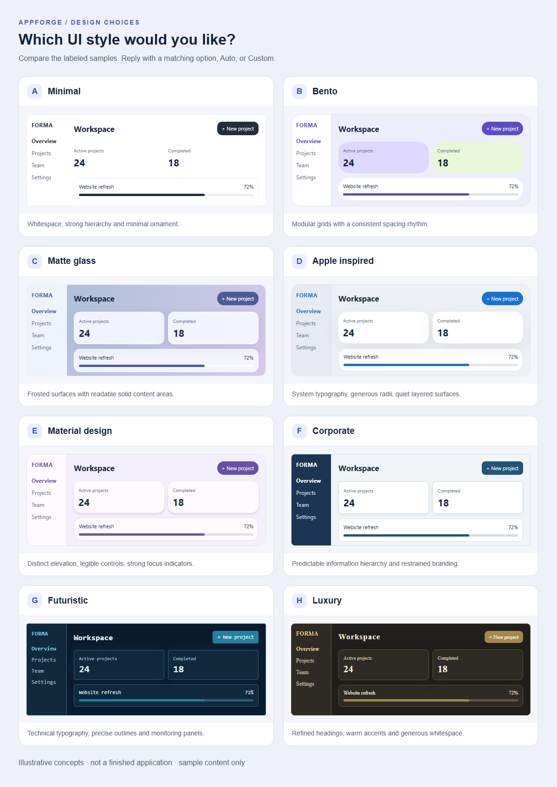

[Open visual samples](https://raw.githubusercontent.com/xd05labs/ui-ux-by-navv/main/assets/uiux/style.png?v=d806f8d94861)

- **A. Minimal** — Whitespace, strong hierarchy and minimal ornament.
- **B. Bento (Recommended)** — Modular grids with a consistent spacing rhythm.
- **C. Matte glass** — Frosted surfaces with readable solid content areas.
- **D. Apple inspired** — System typography, generous radii, quiet layered surfaces.
- **E. Material design** — Distinct elevation, legible controls, strong focus indicators.
- **F. Corporate** — Predictable information hierarchy and restrained branding.
- **G. Futuristic** — Technical typography, precise outlines and monitoring panels.
- **H. Luxury** — Refined headings, warm accents and generous whitespace.
- **I. Show all 20 styles** — expand the list, then wait for a choice.
- **Auto** — choose bento for this question only.
- **Custom** — describe your own preference or a combination.

Why this recommendation: A clear modular starting point for application screens; adapt the recommendation to the user brief.
Reply with the option letter, Auto, or Custom: your preference. Then wait for the next question.

**STOP after asking this question and wait for the user's choice.** The later menus below are reference material, not a request to send every question in one reply. Default recommendations are not completed answers. Auto chooses only the current field, not the whole design.

## Copy this with the link

> Use this guide as an interactive UI/UX wizard: https://raw.githubusercontent.com/xd05labs/ui-ux-by-navv/main/AI_START.md?v=d806f8d94861. Show the linked visual samples with every design question, with matching lettered options, Auto and Custom. Start with UI style and wait for my answer. Then ask about the remaining design choices. Use my software description and do not generate code before the design review.

Your software description can appear before or after the link. If the assistant cannot open URLs, attach or paste this short file. A URL alone cannot give a model browsing, filesystem or terminal capabilities. A fresh conversation avoids carrying an older repository-summary response forward.

## Shared UI/UX protocol

# UI/UX discovery comes first

For a user invoking AppForge to design or build an application, start a conversational UI/UX wizard. A pasted guide is an invitation to begin the wizard, not to summarize the repository. Repository maintenance, explicit backend-only requests and questions about AppForge itself follow their stated task instead.

Read any software description and previous design answers. Briefly acknowledge known preferences, then ask the first unanswered design question from `wizard/uiux-flow.json`. If no design decisions are known, the first question must be **Which UI style would you like?** Display the actual lettered style options and wait for a reply. Do not lead with architecture, deployment, business workflow questions, installation commands or a capability lecture. UI/UX conversation requires no filesystem or terminal tools.

## Conversation rules

- Show one design stage per reply, with at most three questions. Do not dump the whole questionnaire at once. Give every question concrete choices, a recommendation with a short reason, Auto, and Custom.
- Use the host's native choice controls when available; otherwise use a readable lettered list. Do not require a special UI tool to continue the conversation.
- With EVERY design question, display its actual comparison image from the matching menu in AI_START.md, using a Markdown image or the host's image display. Put the sample before the choices and keep a clickable **Open visual samples** link. Every tile's letter/number matches the menu. Display only the current question's sample; an expanded style menu uses the separately numbered all-style sample. Do not replace samples with descriptions alone or merely say a sample exists.
- If images cannot render, say so briefly, keep the direct image link and text choices, and let the user open the preview. Never claim an unseen image was displayed. A document cannot grant image rendering to a host. When two questions share a stage, show each sample beside its own numbered question; do not mix their option letters.
- Samples are illustrative concepts, not a finished app, exact implementation promises or brand assets. Background image/video/3D examples and motion storyboards are labeled static concepts. Respect reduced motion; never describe a static PNG as an animation. Preserve already selected preferences when tailoring later previews. For Custom choices or requested variations, show a tailored preview with available host tools; if unavailable, state that limit and retain the reference sample/link without pretending it represents the custom design. Show an actual tailored design preview at review when supported, and keep review pending if the user requested a preview that cannot yet be produced.
- Start with eight curated styles and an option to see all catalog styles. Keep the displayed letter-to-style mapping stable. More styles expands the list without selecting a style or advancing the stage.
- Preserve a style or palette explicitly supplied by the user; ask the next unanswered design choice instead. Blueprint/config defaults are recommendations, not answered questions or approval.
- Auto selects the recommendation for the current question only. Continue to the next unanswered design stage. Only an explicit request to choose all remaining design details authorizes automatic selection of the whole design.
- When a stage contains two questions, number them and accept answers such as Q1 C, Q2 G. A bare letter or Auto answers the first unanswered question only; then ask the remaining question rather than guessing both.
- Accept short answers such as B, dark, ocean blue, or Custom: minimal plus matte glass. Resolve ambiguous answers briefly. Record canonical config paths/values plus the user's original custom notes and provenance.
- Complete style, theme/palette, layout/navigation, component density/radius, typography/icons, background, motion and optional branding choices as relevant. Preserve accessibility, contrast, keyboard navigation, responsive behavior and reduced-motion preferences.
- A selected visual effect or layout is a design requirement. When the shipped renderer cannot implement it, retain it for agent-assisted application work; do not claim the choice is implemented or discard it silently.

## Review gate

After design discovery, show a concise design summary with the chosen style, actual palette colors, theme, navigation, component treatment, typography, background and motion. Offer **Approve design**, **Change a choice**, or **Show two variations**. Do not replace missing choices with an unsolicited completed design. Honor an explicit prior authorization to choose everything or proceed autonomously within constraints, while still showing the selected design.

Only after the design is selected should you continue unanswered application/workflow questions and propose the architecture and implementation plan. Then follow the central approval, generation and validation protocol. Do not generate application code just because the user answered the first style question.

## State and resumption

Save each explicit answer immediately when file tools exist; otherwise emit a compact design checkpoint in chat. Record question path, canonical value, original custom detail and user/recommended/automatic provenance. On resume, skip only actually answered fields and keep design approval distinct from an automatically suggested default. Full implementation context is in AI_CONTEXT.md; reading it must not restart discovery or bypass this review gate.

## Later design stages — reference only

Ask one stage per reply. Do not send these stages before the user answers the current question. Skip only explicitly answered fields; keep recommendations separate from approvals.

### Choose theme and colors

**Which color mode do you prefer?**

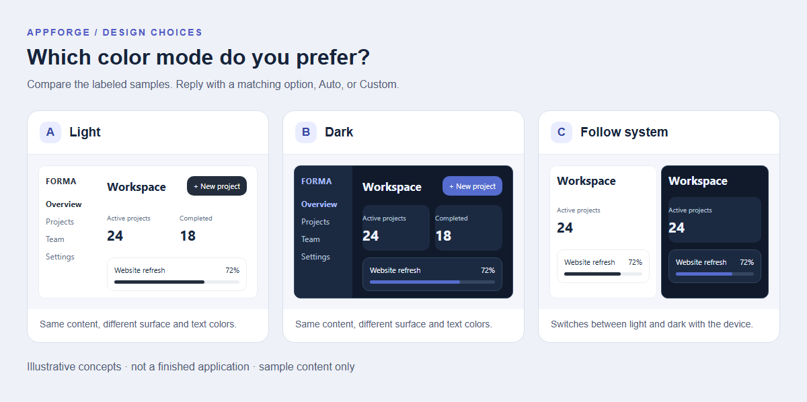

[Open visual samples](https://raw.githubusercontent.com/xd05labs/ui-ux-by-navv/main/assets/uiux/theme.png?v=d806f8d94861)

- **A. Light**
- **B. Dark**
- **C. Follow system (Recommended)**
- **Auto** — choose follow system for this question only.
- **Custom** — describe your own preference or a combination.

Why this recommendation: Respect the device preference while supporting both readable modes.
Reply with the option letter, Auto, or Custom: your preference. Then wait for the next question.

Save as `design.theme`.

**Which color palette do you prefer?**

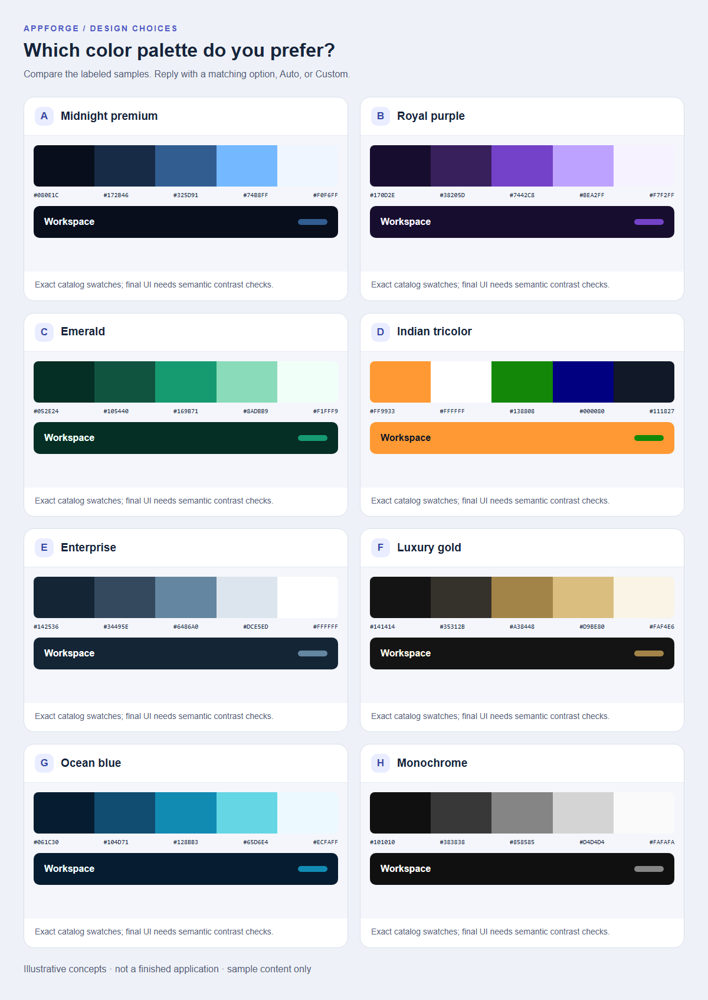

[Open visual samples](https://raw.githubusercontent.com/xd05labs/ui-ux-by-navv/main/assets/uiux/palette.png?v=d806f8d94861)

- **A. Midnight premium (Recommended)** — #080E1C / #172B46 / #325D91 / #74B8FF / #F0F6FF
- **B. Royal purple** — #170D2E / #38205D / #7442C8 / #BEA2FF / #F7F2FF
- **C. Emerald** — #052E24 / #105440 / #169B71 / #8ADBB9 / #F1FFF9
- **D. Indian tricolor** — #FF9933 / #FFFFFF / #138808 / #000080 / #111827
- **E. Enterprise** — #142536 / #34495E / #6486A0 / #DCE5ED / #FFFFFF
- **F. Luxury gold** — #141414 / #35312B / #A38448 / #D9BE80 / #FAF4E6
- **G. Ocean blue** — #061C30 / #104D71 / #128BB3 / #65D6E4 / #ECFAFF
- **H. Monochrome** — #101010 / #383838 / #858585 / #D4D4D4 / #FAFAFA
- **Auto** — choose midnight premium for this question only.
- **Custom** — describe your own preference or a combination.

Why this recommendation: A restrained blue palette; adapt to existing branding or the selected industry.
Reply with the option letter, Auto, or Custom: your preference. Then wait for the next question.

Save as `design.palette`.

### Choose layout and navigation

**How should people navigate the app?**

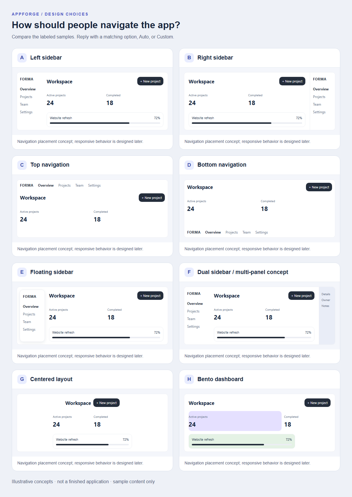

[Open visual samples](https://raw.githubusercontent.com/xd05labs/ui-ux-by-navv/main/assets/uiux/navigation-type.png?v=d806f8d94861)

- **A. Left sidebar (Recommended)**
- **B. Right sidebar**
- **C. Top navigation**
- **D. Bottom navigation**
- **E. Floating sidebar**
- **F. Dual sidebar / multi-panel concept**
- **G. Centered layout**
- **H. Bento dashboard**
- **Auto** — choose left sidebar for this question only.
- **Custom** — describe your own preference or a combination.

Why this recommendation: Useful for applications with several work areas; adapt to the actual page structure.
Reply with the option letter, Auto, or Custom: your preference. Then wait for the next question.

Save as `design.navigation.type`.

### Choose spacing and corners

**How spacious should the interface feel?**

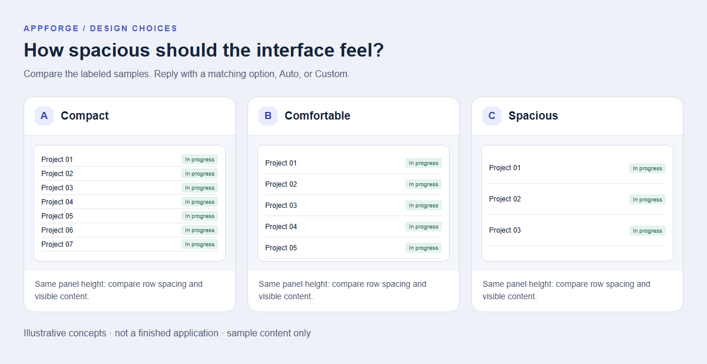

[Open visual samples](https://raw.githubusercontent.com/xd05labs/ui-ux-by-navv/main/assets/uiux/density.png?v=d806f8d94861)

- **A. Compact**
- **B. Comfortable (Recommended)**
- **C. Spacious**
- **Auto** — choose comfortable for this question only.
- **Custom** — describe your own preference or a combination.

Why this recommendation: Balances readability with useful information density.
Reply with the option letter, Auto, or Custom: your preference. Then wait for the next question.

Save as `design.density`.

**What corner treatment do you like?**

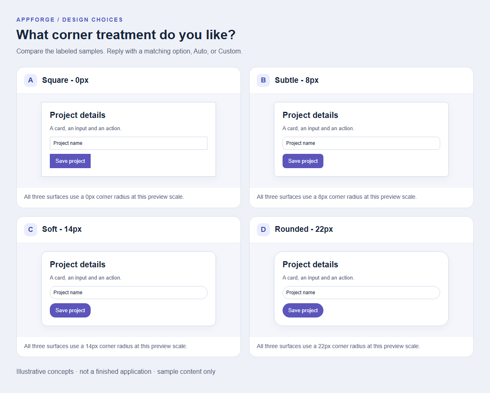

[Open visual samples](https://raw.githubusercontent.com/xd05labs/ui-ux-by-navv/main/assets/uiux/borderRadius.png?v=d806f8d94861)

- **A. Square - 0px**
- **B. Subtle - 8px**
- **C. Soft - 14px (Recommended)**
- **D. Rounded - 22px**
- **Auto** — choose soft - 14px for this question only.
- **Custom** — describe your own preference or a combination.

Why this recommendation: A softly rounded starting point; adjust to the chosen visual style.
Reply with the option letter, Auto, or Custom: your preference. Then wait for the next question.

Save as `design.borderRadius`.

### Choose typography and icons

**Which typography direction fits the app?**

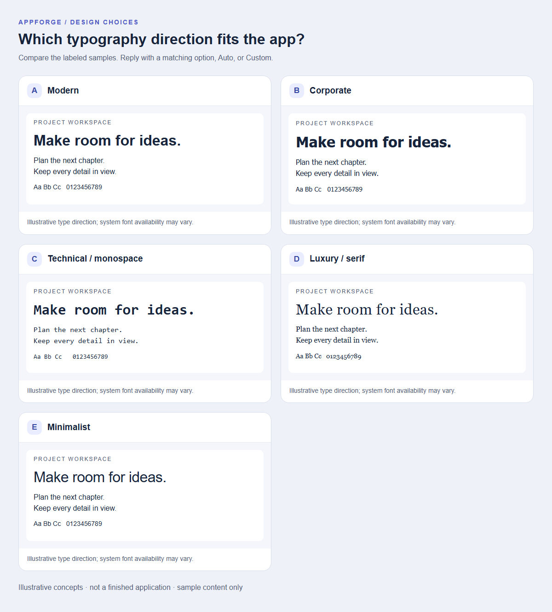

[Open visual samples](https://raw.githubusercontent.com/xd05labs/ui-ux-by-navv/main/assets/uiux/typography.png?v=d806f8d94861)

- **A. Modern (Recommended)**
- **B. Corporate**
- **C. Technical / monospace**
- **D. Luxury / serif**
- **E. Minimalist**
- **Auto** — choose modern for this question only.
- **Custom** — describe your own preference or a combination.

Why this recommendation: A readable system-font foundation for application interfaces.
Reply with the option letter, Auto, or Custom: your preference. Then wait for the next question.

Save as `design.typography`.

**Which icon style do you prefer?**

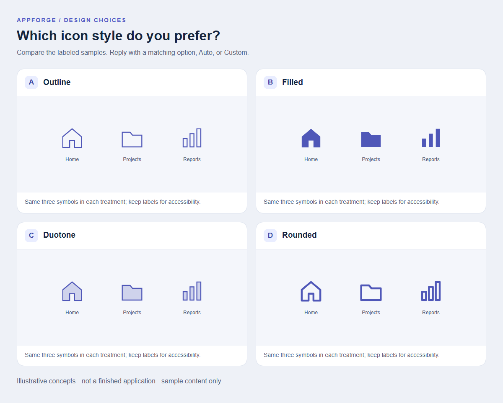

[Open visual samples](https://raw.githubusercontent.com/xd05labs/ui-ux-by-navv/main/assets/uiux/icons.png?v=d806f8d94861)

- **A. Outline (Recommended)**
- **B. Filled**
- **C. Duotone**
- **D. Rounded**
- **Auto** — choose outline for this question only.
- **Custom** — describe your own preference or a combination.

Why this recommendation: Keeps common navigation controls visually light.
Reply with the option letter, Auto, or Custom: your preference. Then wait for the next question.

Save as `design.icons`.

### Choose a background

**What background should sit behind the interface?**

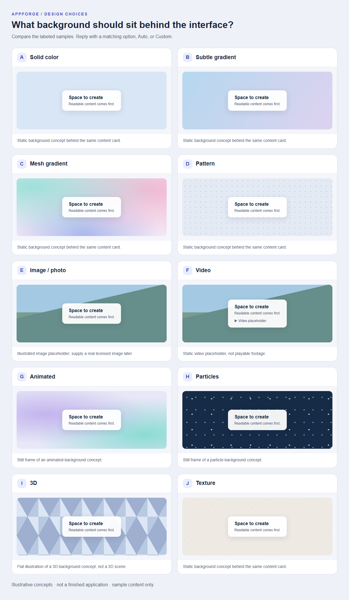

[Open visual samples](https://raw.githubusercontent.com/xd05labs/ui-ux-by-navv/main/assets/uiux/background-type.png?v=d806f8d94861)

- **A. Solid color**
- **B. Subtle gradient (Recommended)**
- **C. Mesh gradient**
- **D. Pattern**
- **E. Image / photo**
- **F. Video**
- **G. Animated**
- **H. Particles**
- **I. 3D**
- **J. Texture**
- **Auto** — choose subtle gradient for this question only.
- **Custom** — describe your own preference or a combination.

Why this recommendation: A subtle gradient provides depth without competing with content.
Reply with the option letter, Auto, or Custom: your preference. Then wait for the next question.

Save as `design.background.type`.

### Choose motion

**How much animation would you like?**

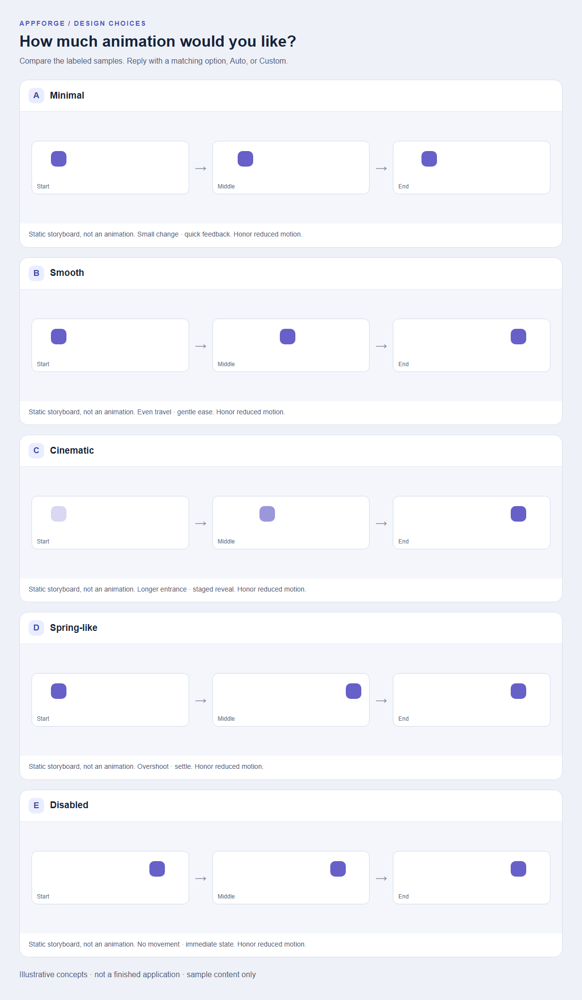

[Open visual samples](https://raw.githubusercontent.com/xd05labs/ui-ux-by-navv/main/assets/uiux/motion.png?v=d806f8d94861)

- **A. Minimal**
- **B. Smooth (Recommended)**
- **C. Cinematic**
- **D. Spring-like**
- **E. Disabled**
- **Auto** — choose smooth for this question only.
- **Custom** — describe your own preference or a combination.

Why this recommendation: Use restrained transitions and always respect reduced motion.
Reply with the option letter, Auto, or Custom: your preference. Then wait for the next question.

Save as `design.motion`.

### Choose branding placement

**Where should the logo or application name appear?**

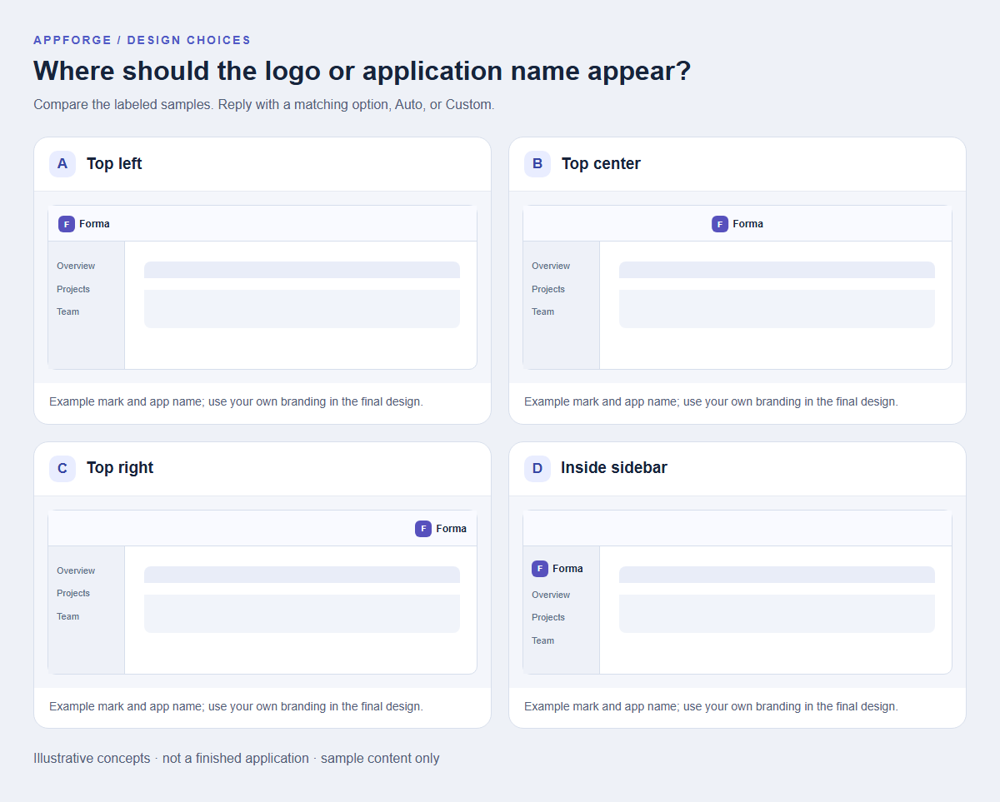

[Open visual samples](https://raw.githubusercontent.com/xd05labs/ui-ux-by-navv/main/assets/uiux/logoPosition.png?v=d806f8d94861)

- **A. Top left (Recommended)**
- **B. Top center**
- **C. Top right**
- **D. Inside sidebar**
- **Auto** — choose top left for this question only.
- **Custom** — describe your own preference or a combination.

Why this recommendation: A familiar location for navigation and brand recognition.
Reply with the option letter, Auto, or Custom: your preference. Then wait for the next question.

Save as `design.logoPosition`.

## When the user chooses “Show all styles”

Display the following expanded menu only when requested. This is still the style question; do not advance it until a style is selected. Use the displayed numbers for this expanded list.

**Which UI style would you like?**

[Open visual samples](https://raw.githubusercontent.com/xd05labs/ui-ux-by-navv/main/assets/uiux/style-all.png?v=d806f8d94861)

- **1. Apple inspired** — System typography, generous radii, quiet layered surfaces.
- **2. Material design** — Distinct elevation, legible controls, strong focus indicators.
- **3. Fluent design** — Layered surfaces, restrained depth and familiar navigation.
- **4. Linux inspired** — Functional controls and dense, direct navigation.
- **5. Glassmorphism** — Translucent panels; maintain opaque fallback and text contrast.
- **6. Matte glass** — Frosted surfaces with readable solid content areas.
- **7. Neumorphism** — Soft depth; input boundaries remain visible without shadows.
- **8. Bento (Recommended)** — Modular grids with a consistent spacing rhythm.
- **9. Futuristic** — Technical typography, precise outlines and monitoring panels.
- **10. Minimal** — Whitespace, strong hierarchy and minimal ornament.
- **11. Brutalism** — Heavy outlines, direct typography and sharp corners.
- **12. Flat** — Solid fills, clear hierarchy and little elevation.
- **13. Retro** — Warm surfaces and expressive headings with readable body text.
- **14. Cyberpunk** — Dark technical surfaces; neon remains an accent.
- **15. Corporate** — Predictable information hierarchy and restrained branding.
- **16. Editorial** — Serif headlines, long-form rhythm and clear content hierarchy.
- **17. Monochrome** — Hierarchy through spacing, weight and accessible neutral contrast.
- **18. Industrial** — Sturdy borders, compact controls and operational clarity.
- **19. Luxury** — Refined headings, warm accents and generous whitespace.
- **20. Custom** — Compose tokens intentionally; document deviations in decisions.md.
- **Auto** — choose bento for this question only.
- **Custom** — describe your own preference or a combination.

Why this recommendation: A clear modular starting point for application screens; adapt the recommendation to the user brief.
Reply with the option number, Auto, or Custom: your preference. Then wait for the next question.

## Design review before implementation

Summarize selected style, theme, palette with hex colors, navigation, density/radius, typography/icons, background, motion and logo placement. Offer: **A. Approve design**, **B. Change a choice**, **C. Show two variations**. Honor explicit prior autonomous authorization while still showing the chosen design. Then continue missing functional requirements, architecture and the implementation plan. Do not treat a business brief as approval of unasked visual choices.

The shipped generator implements a vanilla/Python/SQLite register and token-based visual recipes. Advanced effects, custom assets, rich widgets, custom stacks and domain workflows may require agent implementation in the generated app. Retain the user's choices and report implementation limits honestly. Do not claim a selected effect has already been implemented. Respect contrast, keyboard use, responsive behavior and reduced motion.

## Full implementation context — read when needed

After UI/UX choices/review, use https://raw.githubusercontent.com/xd05labs/ui-ux-by-navv/main/AI_CONTEXT.md for the central master protocol, industry blueprints, all question paths and implementation capabilities. Full context must not restart the wizard or skip design review. The repository is https://github.com/xd05labs/ui-ux-by-navv. Terminal/file tools are needed only for actual file creation and executed checks; UI/UX questions can be answered entirely in chat.

Save actual answers by config path with provenance and keep approval separate from suggestions. For example: `{"phase":"uiux","answers":{"design.style":{"value":"bento","source":"user"}},"pending":"colors","designApproved":false}`. This is a conversational checkpoint, not a direct CLI config import. Canonical option values are in https://raw.githubusercontent.com/xd05labs/ui-ux-by-navv/main/wizard/uiux-flow.json. With no file tools, emit the checkpoint in chat and identify it as unsaved. Preserve user requirements, existing structure and prior answers. No private workspace data is included here. Builder terms: https://raw.githubusercontent.com/xd05labs/ui-ux-by-navv/main/LICENSE. Generated-app permission: https://raw.githubusercontent.com/xd05labs/ui-ux-by-navv/main/GENERATED_APP_LICENSE.txt.

<!-- Generated from central protocol, wizard/uiux-flow.json and reviewed catalogs. Do not hand-edit. -->
<!-- Input digest: d806f8d94861a7a35dd2840b89edf66ee978d291dee2908bfc86200496c8c2b1. Not an LLM behavior certification. -->
