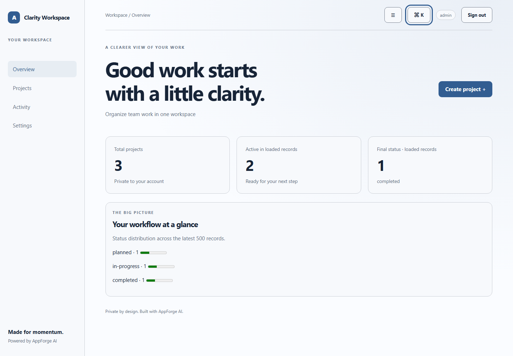

# AppForge AI

**From conversation to complete application.**

## Paste the link and choose your UI/UX

Describe your software if you already know its requirements, then paste this message into your AI assistant:

> Start the interactive UI/UX wizard from https://raw.githubusercontent.com/xd05labs/ui-ux-by-navv/main/AI_START.md. Ask me to choose a UI style first, with lettered options, Auto and Custom. Wait for my reply, then ask about colors, layout and the remaining visual choices. Keep preferences I already gave. Review the design before generating code.

**[Start with AI_START.md](AI_START.md)** — the short UI/UX guide starts with Minimal, Bento, Matte glass, Apple-inspired, Material, Corporate, Futuristic and Luxury options, plus all 20 styles, Auto and Custom. The assistant asks one design stage at a time, preserves existing preferences, and shows the selected design for review. Full implementation instructions/catalogs live in [AI_CONTEXT.md](AI_CONTEXT.md) and are read when needed. If an assistant cannot open links, attach/paste AI_START.md. UI/UX conversation needs no local installation; actual file creation and tests depend on available tools.

See the [link-first guide](docs/link-first.md) for the attachment fallback, expected workflow, host capability limits and owner publishing steps.

Ask. Design. Generate. Validate. Deploy.

**License:** the Builder is source-available under [restricted use terms](LICENSE): viewing and unmodified use are allowed; additional copying, source modification and redistribution require permission. Generated applications may be customized and redistributed under the [generated-app exception](GENERATED_APP_LICENSE.txt). See [licensing and GitHub limits](docs/licensing.md).

AppForge is a provider-independent application building framework. Requirements, wizard logic, design tokens, industry knowledge, generation and validation are separate modules. An agent can use the shared instructions; a developer can run the same workflow locally with Python.

This is a working **v0.1 foundation**, not a claim that every framework, industry workflow or release target is implemented. It includes an executable full-stack workspace adapter, a resumable discovery wizard, interactive design previews, collision-safe regeneration and evidence-based checks. See the [capability matrix](docs/capabilities.md) for precise boundaries.



## Start in two minutes

Requires Python 3.11+. The builder and local generated apps have **no runtime package dependencies**. Run commands from this checkout; network access and an LLM API key are unnecessary.

```sh
python -m appforge doctor
python -m appforge init --name "My Application" --category saas
python -m appforge wizard
python -m appforge plan
python -m appforge preview --serve
```

Review `workspace/requirements.md`, `architecture.md`, `decisions.md` and the interactive preview at http://127.0.0.1:4173. Stop the preview server with Ctrl+C, then:

```sh
python -m appforge approve --yes
python -m appforge generate --dry-run
python -m appforge generate
python -m appforge validate
python workspace/generated-app/server.py
```

Open http://127.0.0.1:8000 and create your own account. There are no default credentials. Use `init --defaults` to record recommended choices without interactive input. `--workspace PATH` goes **before** a command when working on several projects. Source-checkout execution is the supported installation method; do not install a wheel without the repository data files.

## Use with an AI environment

Paste the single-file [AI_START.md](AI_START.md) link with your software description, or open the local repository and ask: “Read START_HERE.md and help me build this application using the description I already supplied.” Codex, Claude Code, Gemini CLI, Copilot, Cursor and Windsurf entry files all point to [one master protocol](ai-core/master-instructions.md). Text-only LLMs can conduct discovery and emit specifications; they must not claim to have written files or executed tests. Repository instructions cannot force automatic execution in every host.

An existing saved project takes precedence over starting discovery again. For repository maintenance, work on the requested framework change; do not launch the application wizard unnecessarily.

## Included today

- **39 CLI discovery questions** and an eight-stage conversational UI/UX flow, concrete/recommended/automatic/custom choices, eight operating modes, immediate checkpoints and answer provenance.
- **19 industry blueprints**, each with pages, workflows, field definitions, proposed models, starter scope and domain extension requirements.
- **20 visual recipes × eight palettes × eight layouts × three densities**, with light/dark/system tokens, adjustable radius, RTL direction and reduced-motion handling. Combinations describe configurable recipes, not individually certified designs.
- Offline interactive design preview with JSON copy/import and semantic contrast measurements.
- Draft 2020-12 configuration schemas plus a dependency-free validator for the repository's documented subset.
- A real vanilla JavaScript/Python WSGI/SQLite generator: private accounts, password hashing, sessions, CSRF checks, roles, CRUD, search/filter, CSV export, audit history and migrations.
- Design-only and backend-only outputs, Docker/Compose files and a pinned deployment server dependency.
- Exact-plan approvals, change-impact dry runs, collision detection, journal recovery and configuration undo.
- Executed test evidence, twelve explicit release gates, CI and reproducible benchmark recording.

The industry starter is a configurable operational register. A commerce blueprint does **not** silently become a checkout system, and a healthcare blueprint is **not** a clinical system. Requested integrations or unsupported technology stacks cause an explicit generation error and route to the agent-assisted extension workflow.

## Change and resume

```sh
python -m appforge status
python -m appforge recommend
python -m appforge wizard
python -m appforge set design.palette emerald
python -m appforge set design.primaryColor '#169B71'
python -m appforge import path/to/project.config.json
python -m appforge plan
python -m appforge approve --yes
python -m appforge generate --dry-run
python -m appforge undo
```

`set` and `import` invalidate approval. Changing generator sources, catalogs or schemas also invalidates approval. Re-plan and review before generation. Undo restores configuration; it preserves existing application code. Regeneration refuses to overwrite edited or unmanaged files. See [recovery](docs/recovery.md).

## Repository map

| Module | Responsibility |
| --- | --- |
| `ai-core/` | Shared operating protocol, capability fallback, decisions and recovery |
| `wizard/` | Declarative questions and adaptive discovery rules |
| `industry-blueprints/` | Category-specific pages, workflows, entities and acceptance criteria |
| `design-engine/`, `design-library/`, `components/` | Palettes, recipes, semantic tokens and shared UI |
| `schemas/` | Portable configuration and checkpoint contracts |
| `appforge/` | CLI, persistence, planning, rendering and validation engine |
| `templates/` | Executable WSGI adapter and declarative stack registry |
| `generators/`, `integrations/`, `plugins/` | Extension contracts and agent-assisted workflows |
| `tests/`, `quality-assurance/`, `benchmarks/` | Verification, release gates and measured comparisons |
| `examples/` | Ready-to-import configurations |
| `workspace/` | Ignored project state and generated output |

## Publish clean project files from Windows

Copy [Publish-Clean.bat](Publish-Clean.bat) into any project root and double-click it for the numbered menu. Choose setup to download/install missing Git or GitHub CLI in the terminal, preview the clean files, then create a private-by-default repository or supply an existing GitHub link. It filters ignores/caches/secrets and pushes an isolated snapshot without changing the project's Git staging area or transferring local history. `Publish-Clean.bat --dry-run` remains an offline-only shortcut. See [publisher setup and limits](docs/publishing.md).

## Verify this repository

```sh
python -m unittest discover -s tests -v
python scripts/check_repository.py
# Refresh the shareable AI guide after editing central instructions/catalogs:
python scripts/build_ai_start.py
python scripts/build_ai_start.py --check
# Optional standards and browser verification:
python -m pip install -r requirements-dev.txt
python scripts/check_repository.py --jsonschema
python -m playwright install chromium
python scripts/browser_smoke.py
# Run the complete local verification bundle:
python scripts/verify.py --full
```

Browser checks generate an isolated reference app, launch a local server, exercise registration/CRUD/search/export/keyboard navigation, check defined viewport overflow and save screenshots plus an evidence report under `artifacts/`. They are not a full accessibility audit. Release targets, including Lighthouse and cross-LLM success rates, remain [unachieved targets](benchmarks/README.md) until measured.

See [START_HERE](START_HERE.md), [architecture](docs/architecture.md), [verification results](docs/verification.md), [security](SECURITY.md), [contributing](CONTRIBUTING.md), and the [roadmap](docs/roadmap.md). AppForge AI is a working name; trademark and name availability have not been verified.
