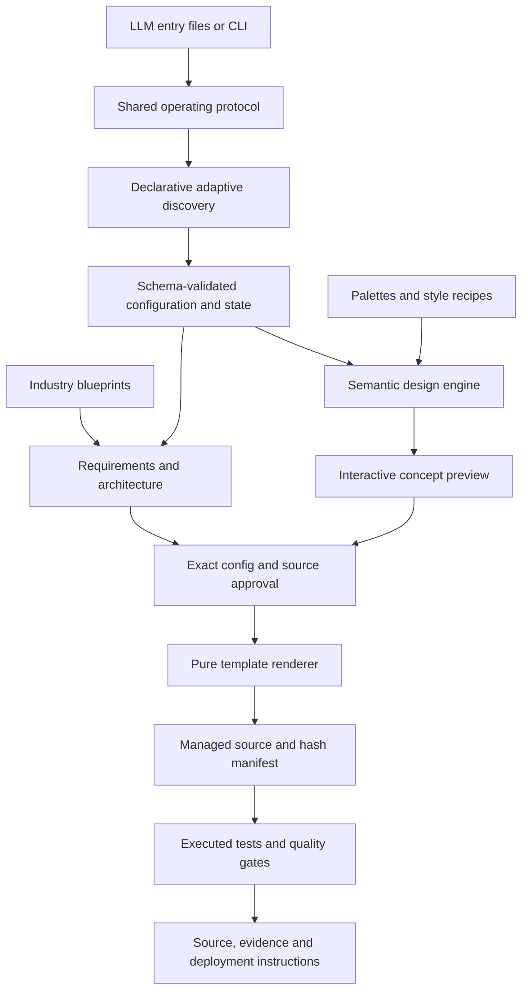

# Architecture

The core uses Python 3.11+ with standard-library JSON, hashing, filesystem and process APIs. It performs no model inference and stores no LLM credentials. Providers are host-level tools governed by portable instructions.

`catalog.py` reads data; `config.py` supplies typed defaults and semantic rules; `schema.py` validates the local schema subset; `wizard.py` applies declarative question conditions; `state.py` owns locks, journals and checkpoints; `design.py` derives CSS and contrast evidence; `planning.py` writes review artifacts and fingerprints relevant inputs; `generator.py` renders in memory before conflict checks; `validation.py` captures actual commands and pending gates; `cli.py` orchestrates these modules.

The same template sources and shared component CSS drive generated apps. A generated application is standalone: it does not import AppForge or read the parent workspace. SQLite migrations and data remain separate from managed source. Unmanaged runtime data is never deleted by regeneration.

## Consistency and failure behavior

Configuration/state updates hold an exclusive lock, save the old pair, write a validated desired-pair journal, then replace both files. Reads replay interrupted commits while locked. Atomic replacement prevents partial individual JSON files; journaling provides pair recovery. It is not a distributed transaction service, and network filesystems with unreliable lock semantics are unsupported.

Generation computes all desired bytes first, preflights all managed paths, compares existing hashes, backs up affected source, writes a rollback journal, updates files and manifest, then commits state. Any unmerged manual edit aborts before source writes. Interrupted generation is explicitly rolled back. A user must not edit a workspace while its CLI operation is running.

Plan hashes include configuration, executable core, templates, schemas, wizard, catalogs, components and central AI instructions. Human-readable plan documents are derived views; edit configuration to change the specification. Editing plan prose does not change the executable contract. AI-reviewed domain changes must be added to typed configuration or implemented under a separate reviewed agent-assisted plan.

## Extension boundary

Add data via catalogs; add renderers behind the pure `render(config) -> dict[path, bytes]` contract; add behavior through explicit adapters. Never load executable code merely because an uploaded plugin manifest names a module. Keep auth, migrations, API semantics and test evidence within each adapter's scope.
